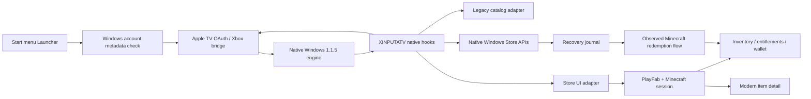

# Architecture and state ownership

The diagram is conceptual: adapters are threads inside the packaged launcher process in the final build, not seven independent installation services. A closed listening port before authentication is expected.

| Loopback port | Owner/protocol | Purpose |
|---|---|---|
| 32115 | BridgeServer / ATVB1 | Exact request authorization/signature and identity fields |
| 32116 | WalletHandler / HTTP | Legacy bootstrap response |
| 32117 | ThumbnailHandler / HTTP | Legacy thumbnail route |
| 32118 | catalog_image_server / HTTP | Catalog image service |
| 32121 | live_wallet_adapter / WAL1 | Real inventory translated to legacy wallet |
| 32122 | store_ui_adapter / four-byte operations | States, details, claims, skin routing, top-up coordination |
| 32123 | ImageHandler / HTTP | Converted gallery PNG cache |

The launcher authenticates before binding bridge/wallet/thumbnail listeners. launch_game starts packaged_services for the remaining adapters, dispatches the native App entry, and monitors account identity. Reuse can select an existing matching bridge. Native controller hooks query those adapters and marshal updates back to UI/game state.

## Identities are separate

- Windows package identity supplies registration, Store API context and native account plumbing.
- Apple TV title identity supplies Xbox service authentication/achievement/presence identity.
- Modern Minecraft/PlayFab authorization supplies inventory/catalog/transaction access.
- Microsoft Store product identity supplies platform checkout.
- A Marketplace offer UUID is not a Store product ID or pack UUID.

Collapsing those identities caused misleading debugging hypotheses. Changing a display name or SCID does not replace native account objects or create Store authorization.

## Lifetimes

Public catalog metadata and artwork references are seed/package content. Inventory/client objects are cached in memory, with account-XUID invalidation in store_ui_adapter.refresh. Inventory refresh TTL is 60 seconds unless forced. Detail JSON and gallery images are disk caches. A cached detail is presentation data, not authorization to buy.

The packaged runtime's STATE uses LOCALAPPDATA/MinecraftAppleTV/Store. Windows package filesystem redirection can place this under the package LocalCache/Local directory. Authentication cache lives separately in LOCALAPPDATA/MinecraftAppleTV/auth-session.bin, protected with current-user DPAPI. Short-lived publisher tokens and native Store keys are not written to the top-up journal.

The top-up journal is durable and account-bound. It exists to survive a crash after a potentially submitted operation. It is not a reusable receipt template. Confirmed credit is reconciled with the native unfulfilled-consumable state before checkout is reopened.

## Why not route everything through HTTPS interception?

An early wallet_https_server prototype used local TLS replacement and hit Python truststore server-context complications. The final packaged design uses scoped native routing and loopback services; the old HTTPS script remains source/history. Do not infer that installing a root CA or globally redirecting official hosts is a prerequisite.
